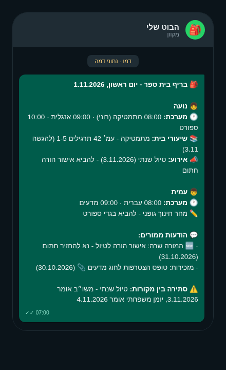

<p align="center">
  
</p>

<h1 align="center">משו״ב, ישר לבוט שלך<br/>מערכת שעות, שיעורי בית והודעות מורים מהמשו״ב, בהודעת בוקר אחת</h1>

<p align="center"><code>mashov-parent-brief</code></p>

<p align="center">
  מערכת שעות, שיעורי בית והודעות מורים של כל הילדים, מרוכזים<br/>
  להודעת בוקר אחת מסודרת בסגנון וואטסאפ, שאפשר לחבר לבוט האישי שלכם.<br/>
  אופציונלי: הצלבה עם היומן המשפחתי לתפיסת סתירות תאריכים.<br/>
  קוד פתוח (MIT) שרץ <strong>אצלכם</strong>, בלי שרת מרכזי ובלי רישום.
</p>

<p align="center">
  <a href="https://opensource.org/licenses/MIT"></a>
  &nbsp;
  <a href="https://agentskills.io/specification"></a>
  &nbsp;
  
  &nbsp;
  <a href="CONTRIBUTING.md"></a>
</p>

<p align="center">
  
</p>

<div dir="rtl">

**מחפשים את תכל׳סקול?** השירות הופסק ([הודעה באתרם](https://tachless.school)).
הפרויקט הזה עצמאי ואין לו קשר אליהם - חלופה בקוד פתוח, self-hosted,
שהנתונים בה נשארים אצלכם.

</div>

## איך נראה הבריף

דוגמה מלאה עם **נתוני דמה** (ככה נראית הרצת הדמו):

> 🎒 **בריף בית ספר - יום ראשון, 1.11.2026**
>
> 👧 **נועה**<br>
> 🕐 **מערכת:** 08:00 מתמטיקה (רוני) · 09:00 אנגלית · 10:00 ספורט<br>
> 📚 **שיעורי בית:** מתמטיקה - עמ׳ 42 תרגילים 1-5 (להגשה 3.11)<br>
> 📣 **אירוע:** טיול שנתי (3.11.2026) - להביא אישור הורה חתום
>
> 👦 **עמית**<br>
> 🕐 **מערכת:** 08:00 עברית · 09:00 מדעים<br>
> ✏️ מחר חינוך גופני - להביא בגדי ספורט
>
> 💬 **הודעות ממורים:**<br>
> · 🆕 המורה שרה: אישור הורה לטיול - נא להחזיר חתום (31.10.2026)<br>
> · מזכירות: טופס הצטרפות לחוג מדעים 📎 (30.10.2026)
>
> 🗓 **מהיומן:** טיול שנתי (4.11.2026)
>
> ⚠️ **סתירה בין מקורות:** טיול שנתי - משו״ב אומר 3.11.2026, יומן משפחתי אומר 4.11.2026

הפלט האמיתי שהקוד מפיק משתמש בכוכבית אחת (`*מודגש*`, מוסכמת העיצוב של וואטסאפ)
כדי שהבוט ישלח כמו שזה: [examples/demo-brief.txt](examples/demo-brief.txt).
כאן הדגמה מעוצבת ב־GFM לקריאה נוחה בגיטהאב.

</div>

<div dir="rtl">

## דרוש מראש: שם משתמש וסיסמה למשו״ב

לפני שמתחילים צריך חשבון הורה פעיל במשו״ב. שם המשתמש הוא תעודת הזהות שלכם,
ואת הסיסמה מגדירים לבד, בחינם, בעמוד הרשמי של משו״ב:

1. נכנסים ל[עמוד הגדרת הסיסמה](https://web.mashov.info/students/recover)
   (או לוחצים ״שכחת סיסמה?״ במסך הכניסה).
2. בוחרים את בית הספר ומזינים ת.ז. ודוא״ל. מעדיפים SMS? לוחצים על
   ״הגדרת סיסמה בעזרת מסרון״ ומזינים במקום זאת את מספר הנייד.
   הדוא״ל או הנייד חייבים להיות רשומים בבית הספר.
3. מתקבל קוד אימות. הקוד פג תוך דקות - מזינים אותו מיד ומגדירים סיסמה חדשה.
4. [מתחברים](https://web.mashov.info/students/login) עם ת.ז. והסיסמה החדשה.
   אחרי הגדרת סיסמה מתחברים תמיד עם ת.ז., גם אם פעם היה שם משתמש אחר.

התהליך נכשל? כנראה שהדוא״ל או הנייד לא רשומים בבית הספר - המזכירות מעדכנת
את הפרטים או מגדירה סיסמה. ההסבר הרשמי של משו״ב:
[מרכז ההדרכה](https://mashovhelp.zendesk.com/hc/he/articles/208803305).

חוץ מזה הסוכן יבקש רק את קוד בית הספר (סמל) ואת שמות הילדים.

## איך מתחילים

בוחרים לפי הסוכן שיש לכם:

### אינסטינקט (איציק)

<p align="right"><a href="https://wa.me/16508702892?text=%D7%AA%D7%A2%D7%A9%D7%94+%D7%9C%D7%99+%D7%92%D7%9D+%D7%9B%D7%96%D7%94%3A+https%3A%2F%2Fgithub.com%2Fofershap%2Fmashov-parent-brief"></a></p>

לחיצה פותחת וואטסאפ עם הודעה מוכנה לאינסטינקט שלכם - שולחים, וממשיכים איתו משם.

### טאב (Tab)

<p align="right"><a href="https://tab.bot/"></a></p>

שולחים לטאב שלכם את הקישור לריפו הזה עם המשפט: "תעשה לי גם כזה".

### סוכני קוד (Claude Code, Cursor, Codex)

מדביקים לסוכן:

```
תגדיר לי את הפרויקט הזה: https://github.com/ofershap/mashov-parent-brief - ההוראות ב-AGENTS.md
```

### בוט טקסט אחר (Pally, Muse ודומים)

שולחים לבוט את [המתכון](recipes/daily-brief.he.md) יחד עם הקישור לריפו הזה.

## פרטיות ושימוש אחראי

- **אין שרת מרכזי של הפרויקט ואין איסוף נתונים מרכזי.** הקוד רץ אצלך.
- זה **לא** מסיר אמון בצד שלישי: אם תחבר בוט ענן, מודל שפה או ספק שליחת
  הודעות, תוכן הבריף יעובד גם אצלם. משתני סביבה מקומיים לא מבטיחים שהנתונים
  נשארים מקומיים.
- לכן כל מתאם/מסירה מתועד: מה זורם לאן ובאילו הרשאות, וברירת המחדל היא צמצום
  (השמטת פרטים מזהים לפני שהטקסט יוצא למודל חיצוני). זו דרישת תיעוד של
  הפרויקט, לא פטור משפטי.
- pymashov היא ספרייה **לא-רשמית** מול API לא מתועד שיכול להשתנות. שימוש
  אישי בלבד, עם החשבון שלך או של ילדך, ובקצב בקשות נמוך. הנתונים הם מידע
  אישי על קטינים - שמור אותם פרטיים.
- סיסמאות: קובץ `.env` מקומי בלבד. לעולם לא בצ'אט, לא בלוגים, לא בריפו.

## שאלות ותשובות

<details>
<summary>פתיחת השאלות והתשובות</summary>

**מה זה משו״ב?**
משו״ב (מיידיות, שקיפות ובקרה) היא מערכת ניהול בתי הספר שבה עובדים כ-1,700 בתי ספר בישראל, עם כמיליון הורים ותלמידים ביום ([כלכליסט, 2021](https://www.calcalistech.com/ctech/articles/0,7340,L-3924112,00.html)). שם מתפרסמים מערכת השעות, שיעורי הבית, הציונים, הנוכחות והודעות המורים. הריפו הזה אוסף ממנה את המערכת, שיעורי הבית והודעות המורים, ובכוונה לא ציונים ואירועי משמעת (שאלה נפרדת על זה למטה).

**איך מקבלים מערכת שעות, שיעורי בית והודעות ממורים במשו״ב אל וואטסאפ?**
מתקינים את הריפו אצלכם (דמו בלי התחברות: `pip install -e . && daily-brief --demo`), מגדירים חיבור לחשבון ההורה שלכם במשו״ב, ומתזמנים ריצת בוקר. הפלט הוא הודעת טקסט אחת בסגנון וואטסאפ שאפשר לחבר לבוט האישי שלכם - ההוראות ב-[AGENTS.md](AGENTS.md).

**למי זה מיועד?**
להורים בישראל שבית הספר של ילדיהם עובד עם משו״ב, ושרוצים הודעת בוקר אחת מסודרת במקום לצלול כל יום לכמה מסכים.

**איפה נשמרים הנתונים שלי?**
אצלך, במופע המקומי שלך. כל משתמש משכפל את הריפו ומריץ מופע משלו על המחשב שלו, עם החשבון שלו. לפרויקט אין שרת מרכזי ואין רישום, והקוד עצמו לא שולח נתונים לשום צד שלישי. קובץ ה-.env עם הסיסמה נשאר מקומי ומכוסה ב-.gitignore. שים לב: כדי לקבל את הבריף אליך תחבר בוט ענן או ספק שליחה (וואטסאפ, מייל וכו׳) - אותו מידע שתבחר לשלוח עובר דרכם, לפי ההרשאות וההגדרות שתגדיר.

**אילו בוטים נתמכים?**
כל בוט שיכול להריץ פקודה מתוזמנת ולקרוא קובץ טקסט: דרך קובץ SKILL.md (תקן Agent Skills הפתוח) או דרך מתכון טקסט חופשי לבוטים מבוססי-שיחה.

**מה עם קבצים מצורפים בהודעות ממורים?**
מסומנים 📎 בלבד - הבריף מודיע שקיים קובץ מצורף, אבל לא מוריד אותו.

**למה אין ציונים ואירועי משמעת בבריף?**
בכוונה. זה מידע רגיש לעיני הורה בלבד, לא לבריף משפחתי שעלול להיקרא על ידי הילדים. הוספה שלהם היא החלטת פרטיות מפורשת של כל משתמש בנפרד.

**כמה זה עולה?**
הקוד עצמו - כלום. קוד פתוח (MIT), רץ על Python וספריות חינמיות, עם תזמון מקומי (cron). בלי חשבונות חדשים לצורך הבריף. שים לב: הבוט האישי שאתה בוחר להפעיל הוא שירות צד-שלישי שעשוי לגבות מנוי משלו - התנאים שלו נבדקים אצלו, לא כאן.

**אילו בתי ספר נתמכים?**
כל בית ספר שעובד עם משו״ב. בתי ספר על מערכות אחרות (Webtop וכו׳) ידרשו מתאם נוסף; החוזה פתוח (`collect() -> DayBrief`).

</details>

## פרויקטים דומים ומקורות

המתאם בנוי על [pymashov](https://github.com/t0mer/pymashov) (Apache-2.0; עדכון קוד אחרון: 9.2026).
פרויקטים נוספים סביב משו״ב ומערכות בית-ספר, לרפרנס ולהשוואה:

- [mitekk/mashov](https://github.com/mitekk/mashov) - בריף הורים RTL למשו״ב (עדכון קוד אחרון: 6.2026)
- [yardnsm/node-mashov](https://github.com/yardnsm/node-mashov) - עטיפת Node.js; צורת ההודעות כאן מגובה בקוד ובפיקסצ׳רים שלהם (עדכון קוד אחרון: 2023)
- [micaelillos/MashovAPI](https://github.com/micaelillos/MashovAPI) - עטיפת Python/Node (עדכון קוד אחרון: 2020)
- [AmitMarcus/MashovMCP](https://github.com/AmitMarcus/MashovMCP) - שרת MCP למשו״ב (עדכון קוד אחרון: 11.2025)
- [תכל׳סקול](https://tachless.school) - שירות מרכזי (לא קוד פתוח) לסיכומי וואטסאפ משו״ב ו-Webtop; **הופסק** - לפי ההודעה באתרם, בעקבות פנייה מצד גורם הקשור לאחת ממערכות בתי הספר

## מפתח? רוצה לנסות על המחשב שלכם?

### התחלה מהירה (דמו, בלי התחברות)

```bash
git clone https://github.com/ofershap/mashov-parent-brief.git
cd mashov-parent-brief
pip install -e .
daily-brief --demo
```

### הגדרה אמיתית מול משו״ב

```bash
pip install -e ".[mashov]"
cp .env.example .env   # ומלאו: ת.ז, סיסמה, סמל בית ספר, שם=מזהה לכל ילד
daily-brief --collector mashov

בריצה ראשונה המתאם יעצור ויבקש כיול של מספור הימים (MASHOV_DAY1_IS):
הריצו, השוו מול המערכת האמיתית באתר משו״ב, ומלאו איזה יום מייצג day=1
(AGENTS.md, צעד 5). לא מניחים את המיפוי בשבילכם.
```

מסלול מודרך לסוכן קוד (clone ← תלויות ← קונפיגורציה ← דמו ← מבחן חיה ← תזמון):
**[AGENTS.md](AGENTS.md)**. תזמון בוקר מקומי לדוגמה:

```cron
0 7 * * 0-4  cd /path/to/daily-brief && .venv/bin/daily-brief --collector mashov --out out/brief.txt
```

<details>
<summary>איך זה בנוי בפנים (ארכיטקטורה, למתעניינים)</summary>

מתאם הוא החלק שיודע לדבר עם מקור נתונים אחד (למשל משו״ב) ולהביא ממנו את המידע לבריף.

## ארכיטקטורה: אגנוסטי למקור, מתאם ראשון משו״ב

```
מקור (מתאם)          ליבה דטרמיניסטית          מסירה
─────────────        ──────────────────        ─────────────
משו״ב (pymashov) ──> DayBrief ← formatter ──> stdout / קובץ
Webtop (עתידי)       (models.py)              הבוט שלך שולח
יומן (עתידי)                                  את הטקסט כמו שהוא
```

מתאם חדש מממש חוזה אחד (`collect() -> DayBrief`). המתאם הראשון משתמש
ב-[pymashov](https://github.com/t0mer/pymashov) (Apache-2.0) כתלות, עם
סשן אחד משותף לכל הילדים כדי להימנע מהצפת התחברויות.

</details>

<details>
<summary>מסלולי חיבור טכניים לפי סוג בוט</summary>

| מסלול | קובץ | למי זה מתאים |
|-------|------|---------------|
| Agent Skill | [skills/daily-brief/SKILL.md](skills/daily-brief/SKILL.md) | בוטים שתומכים בתקן הפתוח של Agent Skills |
| אונבורדינג לסוכן קוד | [AGENTS.md](AGENTS.md) | Cursor, Claude Code, Codex וסוכני קוד אחרים |
| מתכון טקסט | [recipes/daily-brief.he.md](recipes/daily-brief.he.md) | בוטי טקסט עם מחשב משלהם (Tab, Pally, Muse ודומים) |

אין קובץ אחד שכל בוט קורא, אז בחרו את המסלול שמתאים לבוט שלכם. ההוראות אומרות לבוט מתי ואיך להריץ, והקוד מחליט מה נשלח - דטרמיניסטי, בלי שיקול דעת חדש של הבוט בכל בוקר.

</details>

## רישיון

MIT (הריפו הזה). pymashov היא Apache-2.0 ומשמשת כתלות חיצונית. תודה ל־
[t0mer](https://github.com/t0mer/pymashov) על הספרייה.

</div>

## Author

[](https://gitshow.dev/ofershap)

[](https://linkedin.com/in/ofershap)
[](https://github.com/ofershap)
[](https://ofershap.github.io/)

---

<sub>README built with [README Builder](https://ofershap.github.io/readme-builder/)</sub>

## License

[MIT](LICENSE) &copy; [Ofer Shapira](https://github.com/ofershap)

